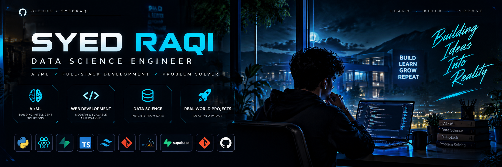

# Hey, I'm Syed Raqi 👋

<p align="center">
  
</p>

<h3 align="center">
  Data Science Engineering Student · Full-Stack Developer · AI/ML Enthusiast
</h3>

<p align="center">
  Building intelligent applications, exploring data, and turning ideas into practical solutions.
</p>

<p align="center">
  <a href="https://github.com/SyedRaqi">
    
  </a>
  <a href="YOUR_PORTFOLIO_URL">
    
  </a>
  <a href="https://github.com/SyedRaqi?tab=repositories">
    
  </a>
</p>

---

## ◈ 01 — ABOUT ME

I'm a fourth-year Data Science Engineering student interested in software engineering, artificial intelligence, and data-driven problem-solving.

- 🚀 Building full-stack applications and AI-powered tools.
- 🧠 Exploring machine learning, data analytics, and intelligent automation.
- 🛠️ Interested in clean code, practical solutions, and scalable application design.
- 🎯 Seeking internship opportunities in software development, AI/ML, and data science.

**My philosophy:** Learn continuously. Build thoughtfully. Improve consistently.

---

## ◈ 02 — FEATURED PROJECTS

<p align="center">
  
  <br>
  <sub>ENGINEERING · ARTIFICIAL INTELLIGENCE · DATA · INNOVATION</sub>
  <br><br>
  <samp>Turning ideas into practical digital experiences.</samp>
</p>

<table>
<tr>
<td width="50%" valign="top">

<p align="center">
  
</p>

<h3 align="center">🚀 CampusConnect AI</h3>

<p align="center"><strong>THE INTELLIGENT CAMPUS ECOSYSTEM</strong></p>

<p>A campus collaboration platform connecting students, faculty, and administrators through a unified digital experience.</p>

**<code>CORE CAPABILITIES</code>**

- 🎓 Role-based campus workflows
- 💬 Collaboration and communication
- 📚 Academic resources and notifications
- 🧠 AI workspace and database integration

**<code>TECH STACK</code>**

<p>
  
  
  
  
</p>

<p align="center">
  <a href="https://github.com/SyedRaqi/CampusAI"></a>
  <a href="https://syedraqi.github.io/CampusAI/"></a>
</p>

</td>
<td width="50%" valign="top">

<p align="center">
  
</p>

<h3 align="center">🧠 SmartHire AI</h3>

<p align="center"><strong>INTELLIGENT CAREER ASSISTANT</strong></p>

<p>A resume intelligence application designed to analyze candidate skills, identify skill gaps, and evaluate alignment with job descriptions.</p>

**<code>CORE CAPABILITIES</code>**

- 📄 PDF resume extraction
- 🎯 Skill-gap analysis
- 🔎 Job-description matching
- 📊 Resume scoring and career insights

**<code>TECH STACK</code>**

<p>
  
  
  
  
</p>

<p align="center">
  <a href="YOUR_SMARTHIRE_REPOSITORY_URL"></a>
</p>

</td>
</tr>
<tr>
<td width="50%" valign="top">

<p align="center">
  
</p>

<h3 align="center">📚 Library Management System</h3>

<p align="center"><strong>SMART LIBRARY OPERATIONS</strong></p>

<p>A database-driven application that streamlines library operations, organizes book records, and simplifies borrowing workflows.</p>

**<code>CORE CAPABILITIES</code>**

- 📖 Book and inventory management
- 👥 Member management
- 🔄 Issue and return tracking
- 📈 Reports and dashboard

**<code>TECH STACK</code>**

<p>
  
  
  
</p>

<p align="center">
  <a href="YOUR_LIBRARY_REPOSITORY_URL"></a>
</p>

</td>
<td width="50%" valign="top">

<p align="center">
  
</p>

<h3 align="center">🌐 Developer Portfolio</h3>

<p align="center"><strong>THE DEVELOPER EXPERIENCE</strong></p>

<p>A personal showcase of technical skills, development projects, and my journey as a Data Science Engineering student.</p>

**<code>CORE CAPABILITIES</code>**

- 💻 Project showcases
- ⚙️ Technical skills and tools
- ✨ Personal branding and presentation
- 🚀 Continuous learning and development

**<code>TECH FOCUS</code>**

<p>
  
  
  
</p>

<p align="center">
  <a href="YOUR_PORTFOLIO_URL"></a>
</p>

</td>
</tr>
</table>

<p align="center">
  
  
  
  <br><br>
  <strong>Learn continuously. Build thoughtfully. Ship meaningful work.</strong>
</p>

## ◈ 03 — TECH STACK

### Languages

<p>
  
  
  
  
</p>

### Frontend and Backend

<p>
  
  
  
  
  
</p>

### Data Science, AI and Tools

<p>
  
  
  
  
  
  
  
</p>

---

## ◈ 04 — GITHUB ACTIVITY

<p align="center">
  
  
</p>

<p align="center">
  
</p>

---

## ◈ 05 — CURRENT FOCUS

```text
[01] Building practical AI-powered applications
[02] Strengthening Data Science and ML fundamentals
[03] Improving full-stack engineering skills
[04] Writing cleaner, testable, maintainable code
[05] Preparing for internships and engineering roles
```

---

## ◈ 06 — LET'S CONNECT

I'm open to internship opportunities, collaborative projects, and opportunities to learn from experienced developers.

<p align="center">
  <a href="https://github.com/SyedRaqi">
    
  </a>
  <a href="YOUR_PORTFOLIO_URL">
    
  </a>
</p>

<p align="center">
  <i>Learn continuously. Build thoughtfully. Ship meaningful work.</i>
</p>

<p align="center">
  
</p>
