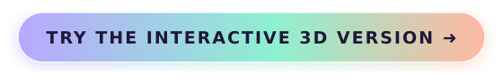

 

Move your mouse over the capsule to tilt it.

Hi, I&rsquo;m **Syed Raqi**. I build web apps, and this is where I keep them: a Flask library system, a bilingual community newsroom, a React news app and my personal site.

| Project | What it is | Built with |
| :--- | :--- | :--- |
| 📚 [**ILMS**](https://github.com/SyedRaqi/ILMS) | Integrated Library Management System: catalog, loans with fines, reservation queues, and member, librarian and admin roles | Flask, SQLite, Vite |
| 🕌 [**MDC**](https://github.com/SyedRaqi/MDC) | A bilingual English and Urdu community newsroom for Madeena Welfare Society, Bhatkal, with an admin CMS | Next.js, TypeScript, Supabase |
| 📰 [**News**](https://github.com/SyedRaqi/News) | *Daily View*, a cinematic editorial news experience with live-news API support | React, Vite, React Router |
| 🌐 [**Portfolio**](https://github.com/SyedRaqi/portfolio) | My personal site, live at [syedraqi.github.io/portfolio](https://syedraqi.github.io/portfolio/) | GitHub Pages |

- 🐙 **GitHub:** [github.com/SyedRaqi](https://github.com/SyedRaqi)
- 🌐 **Portfolio:** [syedraqi.github.io/portfolio](https://syedraqi.github.io/portfolio/)

