

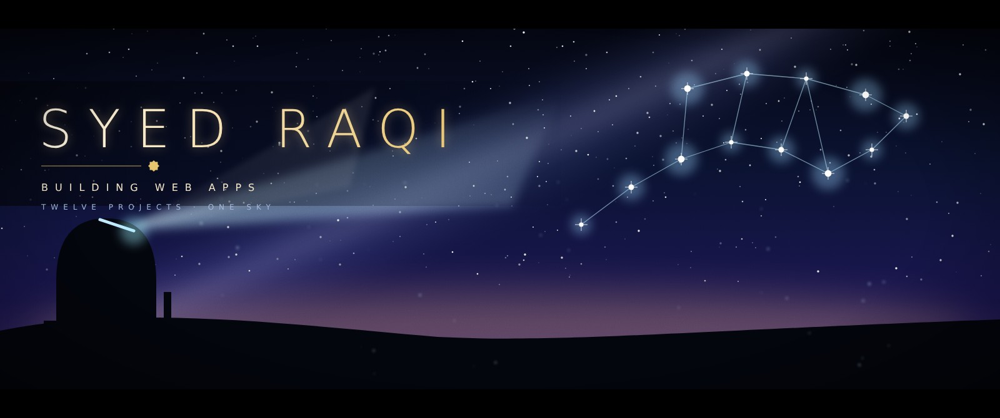

 



Hi, I&rsquo;m **Syed Raqi**. I build web apps, and this is where I keep them: **twelve projects** so far, from an AI resume analyzer and a campus platform to a bilingual community newsroom, a digital magazine, a football intelligence platform and a handful of creative experiments.







<table>
<tr>
<td width="50%" valign="top">
<a href="https://github.com/SyedRaqi/Resume-analyzer">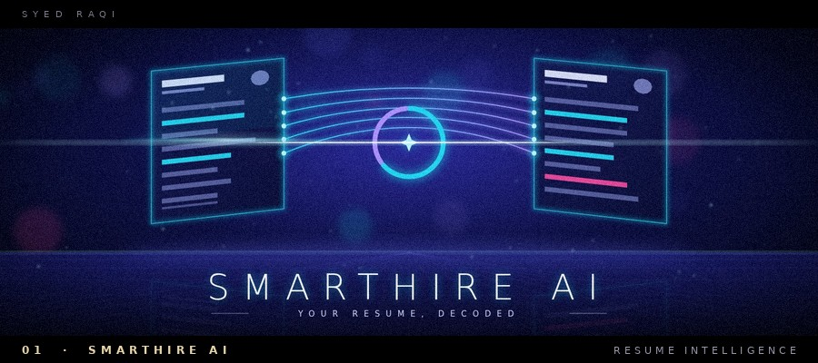</a>

**[SmartHire AI](https://github.com/SyedRaqi/Resume-analyzer)** 
A career intelligence workspace. It reads a resume, compares it with a job description and shows exactly which skills are missing, with scores that show their ingredients. 
React, TypeScript, Vite, FastAPI, SQLAlchemy
</td>
<td width="50%" valign="top">
<a href="https://github.com/SyedRaqi/CampusAI">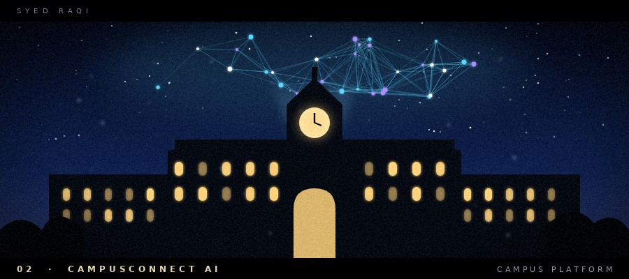</a>

**[CampusConnect AI](https://github.com/SyedRaqi/CampusAI)** 
An AI-powered campus management and student collaboration platform for Anjuman Institute of Technology. 
React, TypeScript, Vite, Supabase
</td>
</tr>
<tr>
<td width="50%" valign="top">
<a href="https://github.com/SyedRaqi/Afterlight">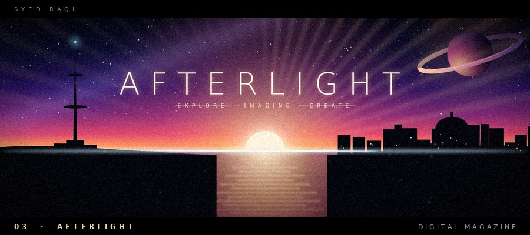</a>

**[Afterlight](https://github.com/SyedRaqi/Afterlight)** 
A futuristic digital magazine and creative inspiration platform that keeps verified facts, research, predictions, scenarios and speculation visibly distinct. 
React, TypeScript, Vite, Supabase
</td>
<td width="50%" valign="top">
<a href="https://github.com/SyedRaqi/MDC">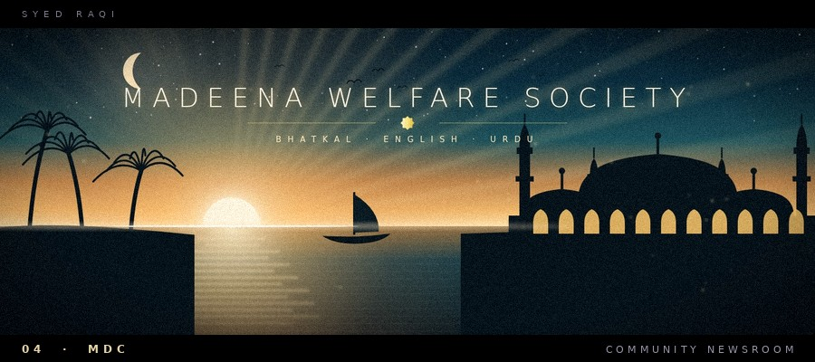</a>

**[MDC](https://github.com/SyedRaqi/MDC)** 
A bilingual English and Urdu community newsroom for Madeena Welfare Society, Bhatkal, with true right-to-left layout and an admin CMS. 
Next.js, TypeScript, Supabase
</td>
</tr>
<tr>
<td width="50%" valign="top">
<a href="https://github.com/SyedRaqi/ILMS">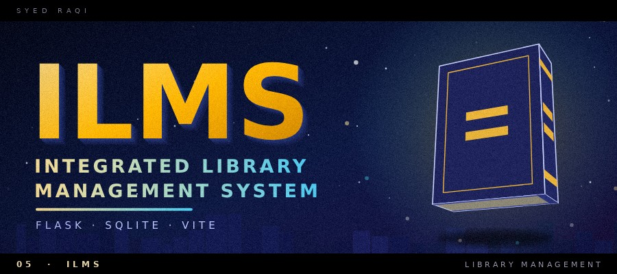</a>

**[ILMS](https://github.com/SyedRaqi/ILMS)** 
An Integrated Library Management System: catalog, loans with fines, reservation queues, and member, librarian and admin roles. 
Flask, SQLite, Vite
</td>
<td width="50%" valign="top">
<a href="https://github.com/SyedRaqi/elite-xi">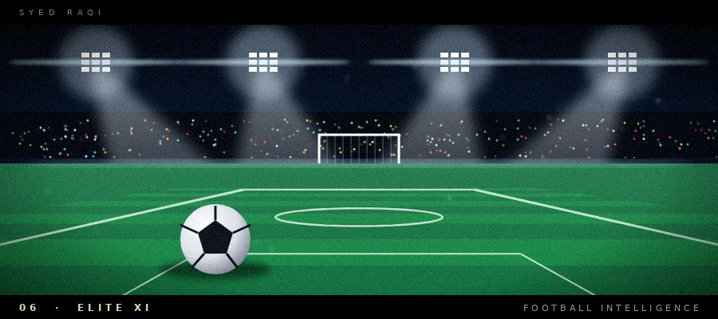</a>

**[Elite XI](https://github.com/SyedRaqi/elite-xi)** 
A cinematic football intelligence platform: discover players, explore clubs and leagues, view profiles and career statistics, follow fixtures and read football analytics. 
React, TypeScript, Vite, Tailwind CSS, Supabase, Framer Motion, Recharts
</td>
</tr>
</table>


<table>
<tr>
<td width="50%" valign="top">
<a href="https://github.com/SyedRaqi/Studio">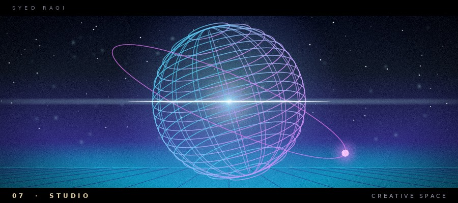</a>

**[Studio](https://github.com/SyedRaqi/Studio)** 
An experimental creative space for building and imagining future products, with smooth scrolling and motion-led design. 
React, TypeScript, Vite, Framer Motion, Lenis
</td>
<td width="50%" valign="top">
<a href="https://github.com/SyedRaqi/News">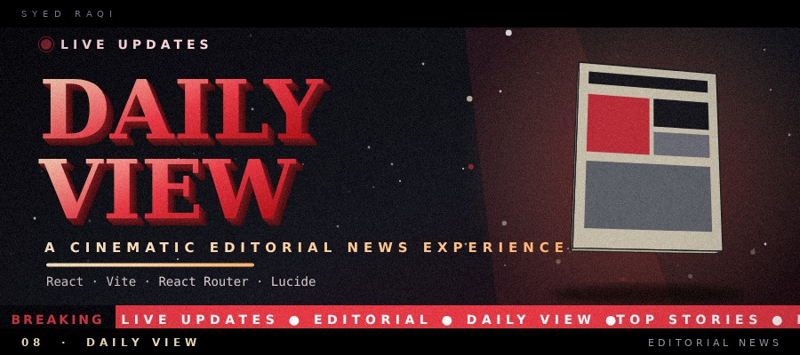</a>

**[Daily View](https://github.com/SyedRaqi/News)** 
A cinematic editorial news experience with local stories and optional live-news API support. 
React, Vite, React Router
</td>
</tr>
<tr>
<td width="50%" valign="top">
<a href="https://github.com/SyedRaqi/Anfal">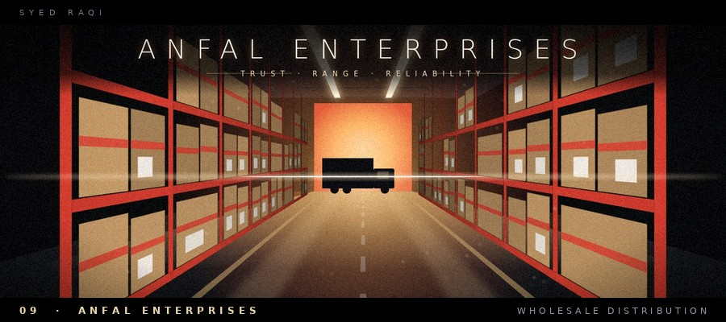</a>

**[Anfal Enterprises](https://github.com/SyedRaqi/Anfal)** 
A single-page marketing site for a wholesale FMCG distributor, built as one HTML file with no build step. 
HTML, Tailwind CSS, JavaScript
</td>
<td width="50%" valign="top">
<a href="https://github.com/SyedRaqi/portfolio">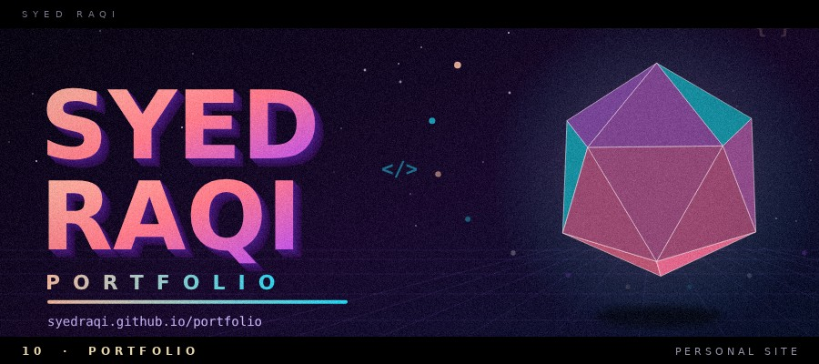</a>

**[Portfolio](https://github.com/SyedRaqi/portfolio)** 
My personal site, live at [syedraqi.github.io/portfolio](https://syedraqi.github.io/portfolio/). 
GitHub Pages
</td>
</tr>
<tr>
<td width="50%" valign="top">
<a href="https://github.com/SyedRaqi/digital_vault">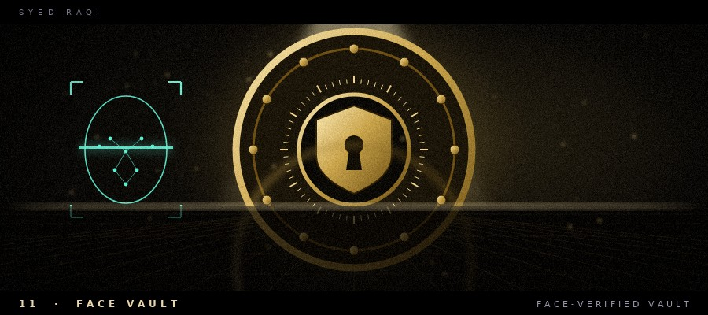</a>

**[Face Vault](https://github.com/SyedRaqi/digital_vault)** 
A cinematic landing page for a digital vault where files and folders can be secured and encrypted, unlocked by face verification. 
HTML, CSS, JavaScript
</td>
<td width="50%" valign="top">
<a href="https://github.com/SyedRaqi/Cipher-Nexus">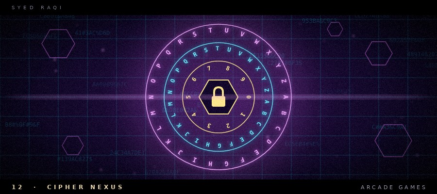</a>

**[Cipher Nexus](https://github.com/SyedRaqi/Cipher-Nexus)** 
A simple browser games site for youngsters, with a leaderboard that works offline or globally through Supabase. 
HTML, CSS, JavaScript
</td>
</tr>
</table>

The artwork on each poster is illustrative, designed for this profile. It is not a screenshot, and no real data is shown.







- **GitHub:** [github.com/SyedRaqi](https://github.com/SyedRaqi)
- **Portfolio:** [syedraqi.github.io/portfolio](https://syedraqi.github.io/portfolio/)

